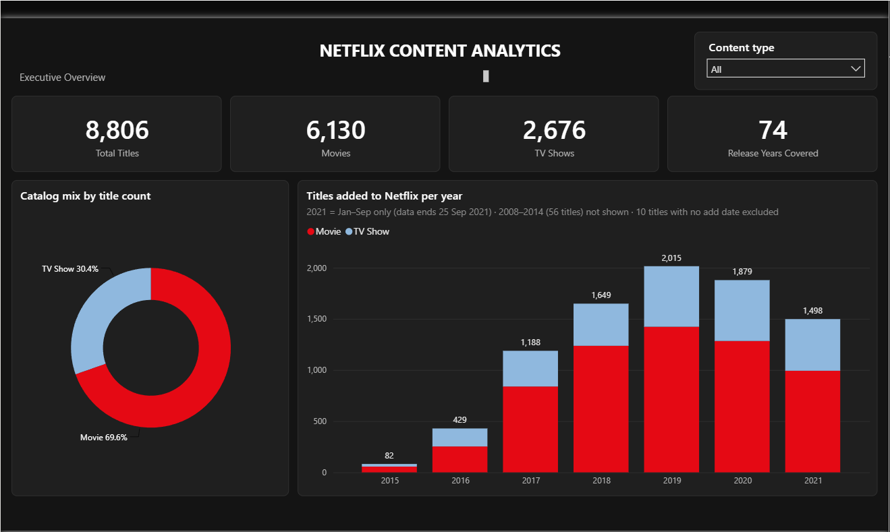
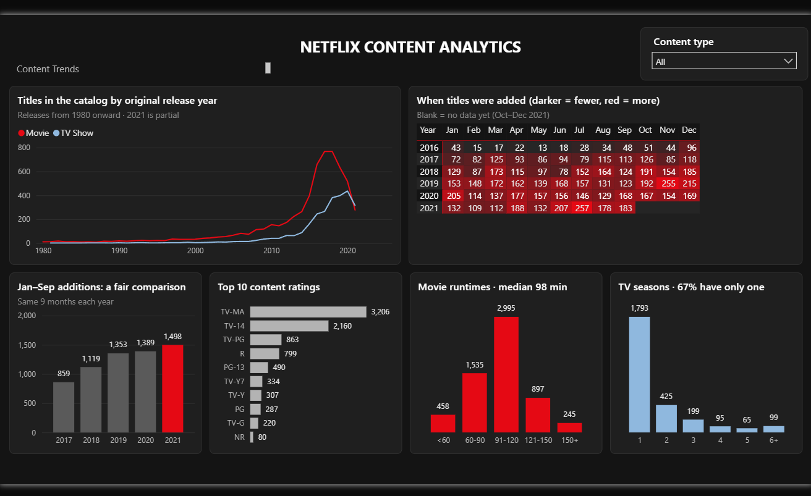
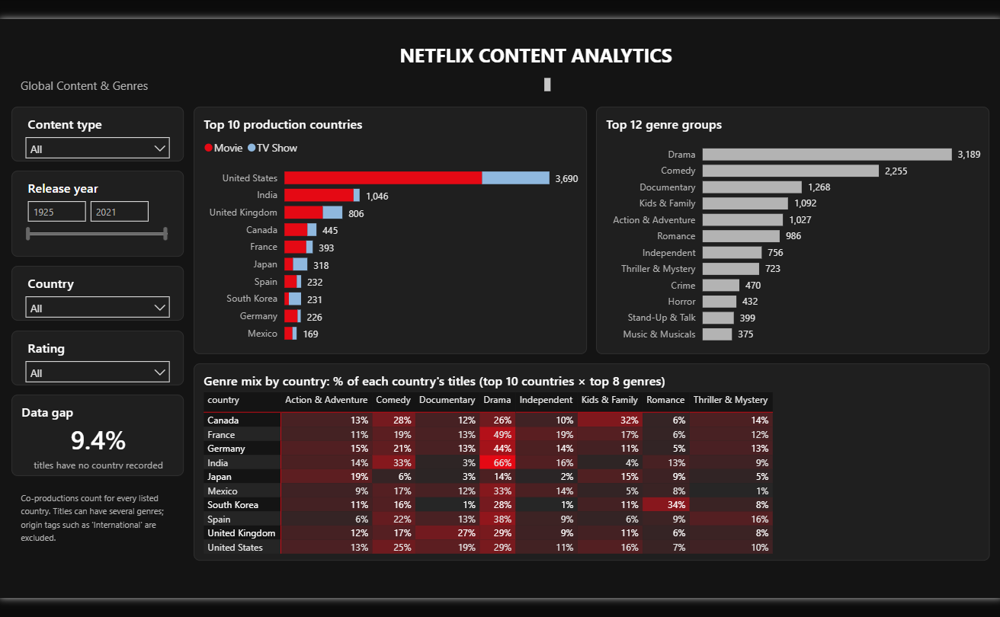
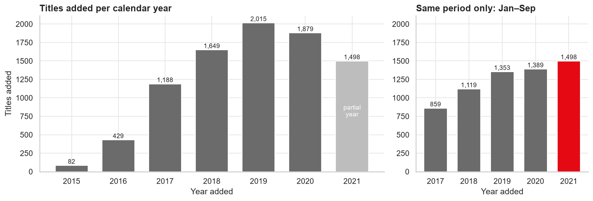
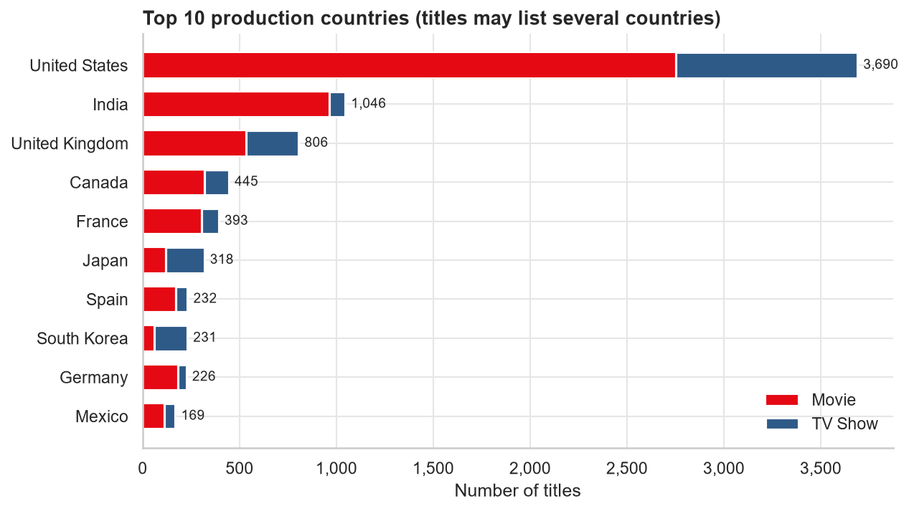
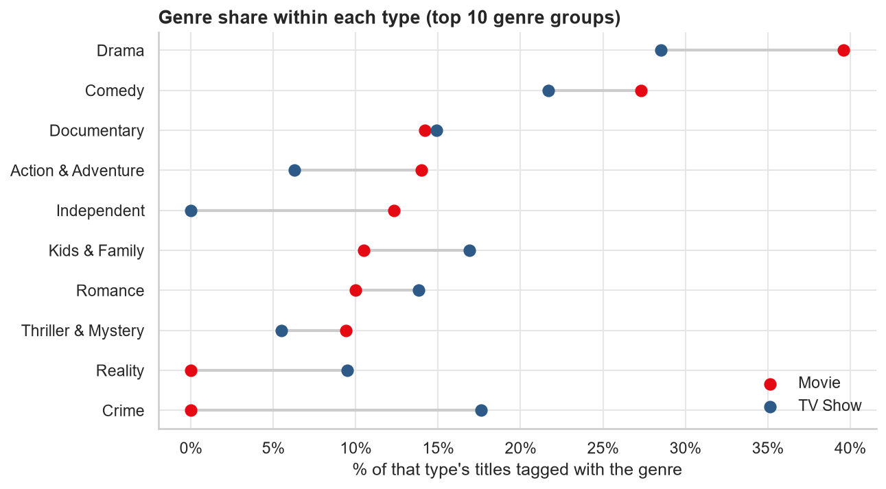
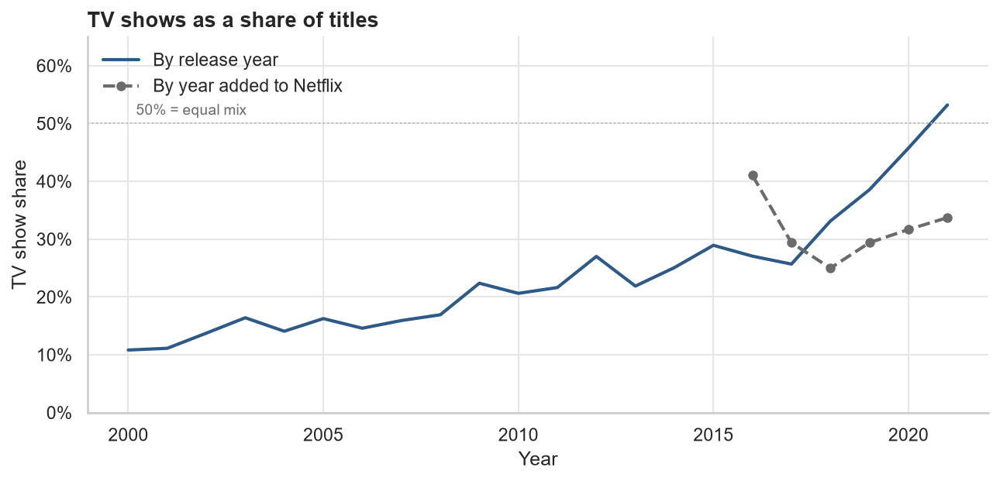

# 🎬 Netflix Content Analytics

**An end-to-end data analytics project that profiles, cleans and analyses Netflix's catalog of 8,800+ movies and TV
shows using Python, PostgreSQL and Power BI.**


---

## 📌 Project overview

Streaming platforms constantly decide what to add to their catalogs. This project analyses Netflix's catalog
metadata to answer: **what does the catalog contain, where does the content come from, and how has the mix
changed over time?**

> **Scope note:** the dataset is *catalog metadata*. It shows which titles exist and when they were added. It
> contains **no viewership, revenue or subscriber data**, so this project describes **what Netflix offers**, not
> what people watch or how the business performs.

## 🎯 Business problem & objectives

A content-strategy team wants a clear, evidence-based picture of the catalog in order to:

1. Quantify the **movie vs TV show** balance
2. Track **catalog growth** over time (and avoid misreading partial periods)
3. Identify the leading **production countries** and **genres**
4. Understand the **audience/rating** mix and **runtime / season** patterns
5. Deliver a reusable, interactive **Power BI dashboard** for exploration

## 🗂️ Dataset

| | |
|---|---|
| **Source** | [Netflix Movies and TV Shows](https://www.kaggle.com/datasets/shivamb/netflix-shows), Kaggle, by Shivam Bansal |
| **File** | `netflix_titles.csv` with 8,807 rows × 12 columns |
| **Coverage** | Titles added Jan 2008 – **25 Sep 2021** (2021 is a partial year) |
| **Columns** | `show_id, type, title, director, cast, country, date_added, release_year, rating, duration, listed_in, description` |
| **Data dictionary** | [`reports/data_dictionary.md`](reports/data_dictionary.md) |

> **Licensing:** the raw and processed CSVs are **not committed** to this repo. Download the file from Kaggle
> (see *Reproduce*). Before redistributing any data, check the licence shown on the Kaggle dataset page and credit
> the original author.

## 🛠️ Tools

| Tool | Used for |
|---|---|
| Python · pandas · NumPy | Profiling, cleaning, feature engineering, validation |
| Matplotlib · Seaborn | Exploratory visualisations |
| PostgreSQL | Relational model + 17 analytical queries (CTEs, window functions, percentiles) |
| Power BI | 3-page interactive dashboard (star schema with bridge tables, DAX measures) |
| Git / GitHub | Version control & documentation |

## 🔄 Workflow

```
data/raw/netflix_titles.csv              (never modified)
        │
        ▼
01_data_understanding.ipynb  →  profile data, data dictionary, issue log (12 issues)
        │
        ▼
02_data_cleaning.ipynb       →  documented fixes + 12 automated validation checks
        │                         data/processed/netflix_titles_clean.csv
        │                         data/processed/netflix_title_countries.csv  (bridge)
        │                         data/processed/netflix_title_genres.csv     (bridge)
        ▼
03_exploratory_analysis.ipynb →  10 analytical questions, 10 charts
        │
        ├──►  sql/schema.sql + sql/netflix_analysis.sql   (PostgreSQL)
        └──►  powerbi/netflix_dashboard.pbip              (Power BI)
                        │
                        ▼
              reports/key_findings.md
```

### Cleaning highlights
- **Investigated duplicates before removing anything.** Only 1 row was a true duplicate (identical apart from an
  invisible non-breaking space in the title). 3 same-name pairs with different add dates were **kept and documented**.
- **Repaired shifted columns.** 3 rows had runtimes (`"74 min"`) stored in the `rating` column.
- **Didn't invent data.** Missing directors became `Not Listed`, missing countries and ratings became `Unknown`, and
  missing add dates were left empty.
- **Split mixed units.** `duration` was split into `duration_value` + `duration_unit` (minutes vs seasons).
- **Normalised multi-value fields.** Comma-separated countries and genres were moved into **bridge tables**.
- **Validated with assertions.** 12 automated checks run before any file is saved.

## ❓ Key analytical questions
1. How many movies and TV shows are in the catalog?
2. How has the catalog's release-year distribution changed?
3. How many titles were added each year?
4. Which countries have the most titles?
5. Which genres appear most frequently?
6. What are the most common content ratings?
7. How do movie durations vary?
8. How many seasons do TV shows typically have?
9. How does the content mix differ between movies and TV shows?
10. What trends appear over time?

## 📊 Dashboard

| Executive Overview | Content Trends | Global Content & Genres |
|---|---|---|
|  |  |  |

Open [`powerbi/netflix_dashboard.pbip`](powerbi/netflix_dashboard.pbip) in Power BI Desktop. The model, its 28 DAX measures and all 3 pages are stored as text (TMDL + PBIR), so every change is reviewable in Git.
The walkthrough of the data model and measures is in [`powerbi/DASHBOARD_BUILD_GUIDE.md`](powerbi/DASHBOARD_BUILD_GUIDE.md).

## 💡 Key findings

| # | Finding | Evidence |
|---|---|---|
| 1 | The catalog is **~70% movies / ~30% TV shows** by title count | 6,130 movies vs 2,676 shows |
| 2 | Additions grew sharply after 2015 and peaked at **2,015 in 2019**. The 2021 "decline" is a **partial-year artefact**: Jan–Sep 2021 (1,498) beat Jan–Sep 2019 (1,353) and 2020 (1,389) | SQL Q4–Q5 |
| 3 | The catalog is **recent**: 84.8% of titles were released 2010 or later | median release year 2017 |
| 4 | The **US is credited on 41.9%** of titles, then India (11.9%) and the UK (9.2%). India is 92% movies; South Korea (73.6%) and Japan (62.6%) are TV-first | bridge-table counts |
| 5 | **46.6%** of titles carry an "International" label. **Drama (36.2%)** and **Comedy (25.6%)** lead | genre groups |
| 6 | **TV-MA** is the top rating (36.4%). Kids content is 13.9% of TV shows vs 4.5% of movies | audience bands |
| 7 | The median movie runs **98 min**, and **67%** of TV shows have only one season available | SQL Q10–Q12 |
| 8 | TV shows are added fresher (median 0 yrs vs 2 yrs for movies). The TV share of additions rose from 25.0% (2018) to 33.7% (2021) | SQL Q13–Q14 |

<details>
<summary>📈 EDA charts</summary>






</details>

Full write-up with limitations: [`reports/key_findings.md`](reports/key_findings.md)

## 🔁 Reproduce the analysis

```bash
git clone https://github.com/Prijesh77/netflix-content-analytics.git
cd netflix-content-analytics
python -m venv .venv
.venv\Scripts\activate          # macOS/Linux: source .venv/bin/activate
pip install -r requirements.txt
```

1. Download `netflix_titles.csv` from [Kaggle](https://www.kaggle.com/datasets/shivamb/netflix-shows) into `data/raw/`.
2. Run the notebooks in order: `01` → `02` → `03` (in `notebooks/`). Notebook 02 writes the processed CSVs.
3. **SQL:** start `psql` from the project root, then:
   ```sql
   CREATE DATABASE netflix_analytics;
   \c netflix_analytics
   \i sql/schema.sql
   \i sql/netflix_analysis.sql
   ```
   Expected output is saved in [`sql/query_results.txt`](sql/query_results.txt).
4. **Power BI:** open `powerbi/netflix_dashboard.pbip`. If your project folder isn't at the original path, update the `DataFolder` parameter (**Transform data → Edit parameters**) to your `data/processed/` folder, then click **Refresh**.

## 📁 Repository structure

```
netflix-content-analytics/
├── data/
│   ├── raw/                    # netflix_titles.csv (not committed)
│   └── processed/              # cleaned + bridge tables (not committed, generated by notebook 02)
├── notebooks/
│   ├── 01_data_understanding.ipynb
│   ├── 02_data_cleaning.ipynb
│   └── 03_exploratory_analysis.ipynb
├── sql/
│   ├── schema.sql
│   ├── netflix_analysis.sql
│   └── query_results.txt
├── powerbi/
│   ├── netflix_dashboard.pbip          # open this in Power BI Desktop
│   ├── netflix_dashboard.Report/       # report pages & visuals (PBIR)
│   ├── netflix_dashboard.SemanticModel/ # tables, relationships, DAX (TMDL)
│   ├── netflix_theme.json
│   ├── DASHBOARD_BUILD_GUIDE.md
│   └── dashboard_screenshots/
├── reports/
│   ├── key_findings.md
│   ├── data_dictionary.md
│   ├── portfolio_kit.md        # LinkedIn post, resume bullets, interview Q&A
│   └── figures/
├── README.md
├── requirements.txt
└── .gitignore
```

## ⚠️ Limitations
- **No performance data.** There are no views, ratings, revenue or subscriber data, so no claims are made about popularity or business impact.
- **Snapshot bias.** The dataset reflects one point in time (Sep 2021). Titles removed before then are missing, so early years are undercounted.
- **Partial 2021.** All 2021 comparisons use same-period (Jan–Sep) logic or are labelled.
- **Title ≠ content volume.** Counts are titles, not hours.
- **TV release year.** This may reflect the latest season, which inflates TV "recency".
- **Country = production country**, not availability. It is missing for 9.4% of titles.
- **Genres are Netflix tags**, and some exist for only one format.

## 🚀 Future improvements
- Join IMDb/TMDB ratings to study critical reception by genre and country
- Add Netflix's published engagement reports to connect catalog with viewing
- Compare multiple catalog snapshots to measure titles added *and removed*
- NLP on `description` to discover themes beyond Netflix's genre tags
- Automate the pipeline (Python script + scheduled Power BI refresh)

## 🙏 Acknowledgements
Dataset by **Shivam Bansal** on Kaggle. This is an independent portfolio project, not affiliated with Netflix.
